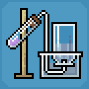

  

<h1 align="center">Education Edition</h1>

<b>Brings Education Edition to Java.</b>

  
  
  
  

---

The chemistry and classroom content from Minecraft: Education Edition is some of the coolest stuff Minecraft has ever had, but it's been stuck on Bedrock behind a school login. This mod brings it over to Java on Fabric, kept as close to the original as possible, down to the creative menu order.

## Features

### Chemistry
- **Element Constructor:** build any of the 118 elements by setting protons, neutrons and electrons. Change the neutrons to make isotopes.
- **Compound Creator:** combine elements into compounds. The recipe book shows every compound you've unlocked and can fill the grid for you.
- **Lab Table:** react elements and compounds together to make new items. Anything that isn't a real reaction fizzles out into Garbage.
- **Material Reducer:** break blocks and compounds back down into their elements.

The Element Constructor, Compound Creator and Lab Table can all be crafted. The Material Reducer can't, so get it from the Creative inventory or buy one from a Master Chemist.

### Products
Everything you make with chemistry: balloons, glow sticks, sparklers, colored torches, underwater torches, underwater TNT, ice bombs, super fertilizer, hardened glass, bleach and more.

- **Balloons** float, sway on their own, and tie to mobs, boats or fences with a real lead. Tie one to a mob and it lifts it off the ground. Hit the balloon and it drags the mob along. If it pops up high, whatever was tied to it falls back down.
- **Medicines** (Antidote, Elixir, Eye Drops and Tonic) are brewed in a regular brewing stand.

### Classroom tools
- **Chalkboards:** Slates, Posters and Boards to write on, on a wall or standing on legs. The text looks like it does in Education Edition. World Builders can lock a board so only they can edit it, and boards a World Builder places can only be broken by World Builders.
- **Camera and Portfolio:** take pictures in-game or set the camera up on its tripod for a selfie. The pictures go into your portfolio.
- **NPCs:** place characters with names and dialogue around your world. They turn to watch you when you get close.
- **Allow, Deny and Border blocks:** control where people can build and where they can go.

### Chemist villager
A villager without a job who finds a Lab Table becomes a **Chemist**. Chemists wear a lab coat and goggles and trade elements, salt, bleach, glow sticks, sparklers, balloons, medicines and more. Master Chemists sell the Material Reducer.

Villages can generate a **Chemist's lab**, with its own design for each village type: plains, desert, savanna, snowy and taiga. Each lab comes with a Lab Table, a loot chest of chemistry supplies and a villager to move in.

### Control tips
Education Edition's on-screen control tips, using your own key bindings:
- **Right side:** what your buttons do right now (Place, Mine, Attack, Trade, Eat, Drop and so on). The list follows what you're looking at and holding, and moves up out of the way of closed captions.
- **Left side:** press **H** to open a panel of the movement and menu keys, and number every hotbar slot with its key. Press **H** again to hide it.

Control tips can be switched off in **Options → Controls → Control Tips**. The H key can be rebound under **Controls → Miscellaneous**.

### Chemistry Guide
Craft the guide book with a **book** and a **glass bottle**. It's a two-page book with every recipe in the mod, with pictures, and explains how the stations and classroom tools work.

## Turning it on
Everything in the mod is tied to a world setting, like Bedrock's Education Edition toggle. It's off by default.

- **New worlds:** switch on **Education Edition** on the world creation screen.
- **Existing worlds:** run `/gamerule edu:education_features true`.

While it's off, the Education Edition creative tab is hidden, labs don't generate in villages and control tips don't show.

## World Builder
| Command | What it does |
| --- | --- |
| `/wb` | Turns World Builder on or off for yourself |
| `/wb <players>` | Turns it on or off for those players |
| `/wb <players> true\|false` | Sets it for those players |

`/worldbuilder` works the same way. World Builders can build anywhere, edit NPCs and locked chalkboards, and ignore the permission blocks.

Only the world's host can use World Builder commands, or owner-level operators on a dedicated server. Players who join your world can't give it to themselves. The commands also work in command blocks, functions and the server console.

### Game rules
| Rule | Default | What it does |
| --- | --- | --- |
| `edu:education_features` | `false` | Switches all of the mod's content on or off |
| `edu:immutable_world` | `false` | Only World Builders can build, except above Allow blocks |

## Installation
1. Install [Fabric Loader](https://fabricmc.net/use/) for Minecraft 26.1.2.
2. Put [Fabric API](https://modrinth.com/mod/fabric-api) in your `mods` folder.
3. Download one of the jars and put it in your `mods` folder:
   - `education-edition-<version>+26.1.2.jar` works on its own.
   - `education-edition-<version>+26.1.2-jei.jar` also adds JEI support: element, compound and Lab Table recipes, and the medicines in JEI's brewing tab.

You don't need JEI to play.

## Requirements
| | |
| --- | --- |
| Minecraft | 26.1.2 |
| Fabric Loader | 0.19.3 or newer |
| Fabric API | any |
| Java | 21 or newer |
| JEI | optional |

## License
The mod's code is licensed under the [MIT License](LICENSE).

This is a fan port and isn't affiliated with Mojang or Microsoft. The original Minecraft textures, sounds and other assets belong to Mojang and aren't covered by the MIT license.

## Bugs and suggestions
Found a bug or something that doesn't match Education Edition? Open an [issue](../../issues). The mod is still being worked on.
